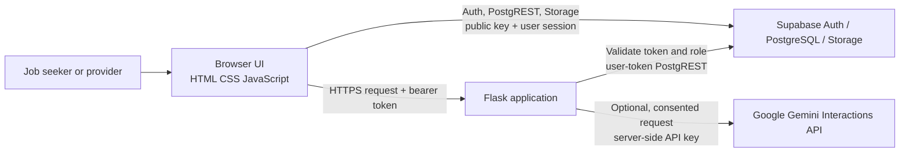
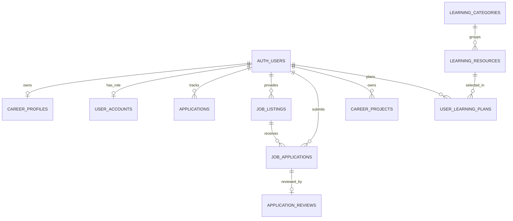

# CareerLens

## B.Tech CSE Minor Project

| Title-page field | Editable value |
|---|---|
| Student name | `[Enter student name]` |
| College / university | `[Enter college or university]` |
| Department | `[Enter department]` |
| Academic year | `[Enter academic year]` |
| Project guide / supervisor | `[Enter guide or supervisor name]` |

---

## Abstract

Career development commonly involves separate tools for maintaining a profile,
tracking applications, identifying skill requirements, finding learning
materials, and preparing for interviews. This project presents CareerLens, a
web application that brings several of these activities into one workspace.
The implemented application uses Python and Flask for server-rendered pages
and selected APIs, HTML/CSS/JavaScript for the interface, and Supabase for
authentication, PostgreSQL data, and private résumé storage. Optional,
user-consented career-assistance requests are sent from Flask to the Google
Gemini Interactions API.

The repository includes personal application tracking and career profiles,
explainable skill-gap analysis, a learning-resource
catalogue and personal learning plans, deterministic profile-to-job evidence
matching, provider job and applicant workflows, portfolio projects, dashboard
summaries, interview-practice generation, and optional AI assistance. The
learning catalogue is administrator-managed; résumé analysis is textual and
does not create résumé documents.

Automated local validation uses Python `unittest` and Node's built-in test
runner. The latest Phase 9 validation run is recorded in
[`TESTING_SUMMARY.md`](TESTING_SUMMARY.md). These tests include mocked
Supabase/Gemini calls and static SQL-policy assertions. No live Supabase,
Gemini, or deployed-site evaluation is claimed. Matching and analysis results
are deterministic text heuristics, not validated measures of proficiency,
hiring probability, or employment outcomes.

## Chapter 1: Introduction

### 1.1 Background and motivation

Job seekers may need to maintain a profile, compare their experience with job
requirements, organize applications, plan learning, and prepare for
interviews. Employers may separately need to publish roles and review
applications. When these activities are handled in unrelated tools, users
must repeatedly enter information and may have difficulty seeing how their
career evidence relates to a target role.

CareerLens is a student project exploring a unified workspace for these
activities. It combines profile and application records with deterministic
text analysis, curated learning links, private project evidence, and an
employer-side job workflow.

### 1.2 Problem statement

The project addresses the software-design problem of integrating career
planning and job-application activities in a single web application while
keeping account data separated and communicating the limits of automated
text-based recommendations.

### 1.3 Objectives

The implemented objectives are to:

1. Provide separate job-seeker and job-provider workspaces.
2. Maintain private career-profile and application-tracking records.
3. Analyze readable PDF résumé text against a supplied job description.
4. Identify recognized skill mentions and explain what evidence was or was not
   found in supplied text.
5. Connect skills marked for further assessment to matching catalogue
   resources and a personal learning plan.
6. Compare explicit job requirements with profile, portfolio, and available
   learning-plan evidence using an explainable deterministic score.
7. Support employer job listings, applicant status management, and private
   reviewer notes.
8. Provide portfolio and dashboard views and interview-practice prompts.
9. Offer optional Gemini assistance only after the user consents to send text.

The application does not establish that these objectives improve hiring
outcomes; that would require separate empirical evaluation.

### 1.4 Scope and intended users

The implemented user roles are **job seeker** and **job provider**. A seeker can
maintain a profile and personal application tracker, analyze supplied text,
browse published listings, apply to a listing, save learning resources, and
maintain portfolio projects. A provider can manage its own listings and review
applications to those listings. Provider account type is selected at account
registration; the repository does not implement external employer identity
verification.

The application supports readable text extracted from PDF files and does not
perform OCR on scanned images. Learning resources must be curated by an
administrator in Supabase; the application does not include a catalogue
management interface. Browser-level end-to-end testing and live external
service verification remain outside the current validation evidence.

### 1.5 Expected contribution

CareerLens demonstrates how a small Flask application can combine Supabase
authentication and row-level access policies with local, explainable career
text-processing logic and user-controlled data. Its contribution is a
working software prototype and integration design, not a validated employment
assessment or a measured intervention.

## Chapter 2: Existing System and Proposed System

### 2.1 General workflow context

Career profiles, applications, learning plans, job listings, and interview
preparation are often represented in separate services or documents. Such
separation can require repeated data entry and make it less convenient to
review related career information together. This observation motivates the
project; it is not the result of a user survey or comparative market study.

### 2.2 Proposed system

CareerLens combines personal career records and employer workflows in a
browser-based application. Supabase provides identity, persistence, and
private storage. Flask serves the interface and provides endpoints for
authenticated analysis and data-proxy operations. JavaScript renders the
workspace and uses the signed-in Supabase session for authorized database and
storage operations.

### 2.3 Comparison

| Aspect | Fragmented workflow (general context) | CareerLens prototype |
|---|---|---|
| Profile and portfolio | May be maintained separately | Career profile and private project records are available in the seeker workspace |
| Application records | May be kept in separate notes or tools | Manual tracker and CareerLens-submitted applications are separately summarized |
| Skill comparison | May require manual review | Built-in vocabulary identifies mentions and shows evidence excerpts |
| Learning | May be planned separately | Curated catalogue items can be saved to a personal progress plan |
| Job matching | May depend on manual comparison | Deterministic evidence-alignment indicator explains recognized requirements |
| Employer workflow | May use separate listing and applicant tools | Provider workspace supports owned listings and applicant-stage management |

This comparison describes project scope only. It does not assert superiority
over any named product or establish measurable user benefits.

### 2.4 Benefits and limitations

Potential benefits include a consolidated view of several career activities,
visible evidence excerpts, and explicit notices that text matches and
self-reported data do not verify skill proficiency. Limitations include a
finite skill vocabulary, no OCR, an administrator-managed resource catalogue,
dependence on configured Supabase services, and no evidence from a user study
or live production deployment.

## Chapter 3: Requirements Analysis

### 3.1 User roles

- **Job seeker:** manages personal profile and manual applications; analyzes
  résumé/job-description text; browses jobs; submits applications with a PDF;
  tracks learning and portfolio records.
- **Job provider:** manages its own listings; reviews applicants to those
  listings; updates application stages and provider-only review data.
- **Catalogue administrator:** uses the Supabase SQL Editor to curate resource
  categories and resources. This is an administrative operation, not an
  in-app application role.

### 3.2 Functional requirements and status

| Requirement | Status in repository |
|---|---|
| Email/password sign-up and sign-in, email verification, password reset | Implemented through Supabase client; live provider flow not verified |
| Role-specific seeker/provider workspace | Implemented; live account/RLS behavior not verified |
| Career profile and personal application tracker | Implemented with direct Supabase client operations; live persistence not verified |
| Skill-gap analysis with evidence explanations | Implemented with deterministic skill vocabulary and supplied profile/resume/experience/project context |
| Learning catalogue and personal plan | Implemented; catalogue data and persistence require Phase 3 migration and Supabase |
| Explainable job recommendations | Implemented as deterministic text/evidence scoring; live records not verified |
| Provider job listing and applicant workflow | Implemented in browser and guarded by database policies; live flow not verified |
| Application résumé upload and private access | Implemented via Supabase Storage; actual object-level access not live tested |
| Portfolio project CRUD | Implemented through Flask APIs and Phase 5 migration; live persistence not verified |
| Career dashboard | Implemented using loaded profile, projects, plans, applications, and recommendations; live aggregation not verified |
| Interview preparation | Implemented as deterministic prompt generation; no model is required |
| Gemini assistance | Implemented as optional, explicitly consented server-to-server calls; not live tested |
| Résumé authoring | Not implemented |
| In-app learning-catalogue administration | Not implemented |

### 3.3 Non-functional requirements

The application is designed to use authenticated requests, role-aware behavior,
database row-level security, private résumé storage, input and upload limits,
and sanitized errors. The supplied local tests validate selected logic and
request contracts. They do not prove live policy enforcement, accessibility,
responsive behavior, availability, or production performance.

### 3.4 Software and hardware requirements

- Python 3.12 (repository `.python-version` and CI configuration)
- Python dependencies pinned in `requirements.txt`
- A modern browser with JavaScript enabled
- Node.js for the repository's built-in JavaScript tests
- Supabase project for account-backed application features
- Optional Gemini API key for AI assistance
- Network access to Supabase, the Google Gemini API when enabled, and the
  Supabase JavaScript client CDN

No measured minimum hardware specification is available. The project does not
require a local database server.

### 3.5 Assumptions and constraints

The Supabase SQL files are the available schema source; the live database was
not inspected. Accounts must be configured with appropriate redirect URLs.
Published jobs and learning resources must exist in the configured Supabase
project. The app uses user bearer tokens and the public Supabase key; privileged
service-role keys are not required by the inspected application. Gemini is
optional. Feature availability depends on applying the relevant SQL files in
the correct order.

## Chapter 4: System Architecture and Design

### 4.1 Architecture overview

The browser loads Flask-rendered HTML and static frontend assets. Supabase
JavaScript v2 is loaded from a CDN. Supabase Auth creates and maintains the
browser session. The browser uses that session and the public anon/publishable
key for authorized PostgREST and Storage operations. For Flask APIs, it sends
the current access token in an Authorization bearer header. Flask verifies the
token through Supabase Auth, performs role checks where required, and forwards
selected database requests with that same user token. Optional Gemini calls
are sent only by Flask using a server-side API key after consent.

This diagram represents code paths visible in the repository. It does not
represent a verified deployed topology.

### 4.2 Main components

- **Frontend:** `backend/templates/index.html`,
  `backend/static/script.js`, `backend/static/dashboard-ui.js`,
  `backend/static/learning-ui.js`, and `backend/static/style.css`.
- **Flask entry point and APIs:** `backend/app.py`.
- **Deterministic processing:** `backend/skill_gap.py`,
  `backend/job_matching.py`, `backend/learning.py`, and
  `backend/interview_prep.py`.
- **Persistence and policy definitions:** `backend/supabase_schema.sql` and
  `backend/migrations/phase3_learning.sql`,
  `backend/migrations/phase5_portfolio.sql`.
- **Automated tests:** Python `unittest` modules and Node `.cjs` tests under
  `tests/`.

### 4.3 Major data flows

1. **Authentication:** the browser signs in/signs up with Supabase Auth and
   loads the account type from `user_accounts`.
2. **Direct database operations:** profile, personal applications, listings,
   job applications, and provider review data use the Supabase JavaScript
   client and the current user's session. RLS is intended to constrain rows.
3. **Skill analysis:** an authenticated seeker submits a role, job text, and
   optional skills, experience, résumé PDF; Flask also retrieves that user's
   private portfolio through the authenticated proxy and returns evidence
   categories and explanations.
4. **Job recommendations:** Flask retrieves the seeker's profile, projects,
   published jobs, and learning records through Supabase; deterministic
   processing returns job explanations, profile status, and score details.
5. **Learning and portfolio APIs:** Flask validates payloads and identifiers,
   forwards requests with the user's bearer token, and maps service errors to
   safe responses.
6. **Gemini:** after explicit per-request consent, Flask sends the selected
   text to Google with `store: false` and returns model text. CareerLens does
   not persist the request in its own application database.

### 4.4 Authorization boundaries

The frontend hides role-specific pages/options for usability. Flask also
requires authentication and checks seeker roles for seeker analysis, learning,
recommendations, and portfolio APIs; employer-specific Gemini tasks require a
provider role. Direct Supabase operations rely on SQL grants and RLS policies.
The SQL definitions and tests were reviewed locally, but the live database's
policies were not queried or exercised. Therefore this design description is
not a claim of runtime security verification.

## Chapter 5: Database Design

### 5.1 Evidence and verification status

The following descriptions are derived from the checked-in base schema and
migrations, not a live database introspection. The schemas must be applied
manually. A static text assertion in the tests checks selected RLS contract
fragments; it does not execute policies or establish that a deployed database
matches these files.

### 5.2 Tables and key attributes

| Table | Primary key and key columns | Relationships / purpose |
|---|---|---|
| `applications` | `id`; `user_id`, `title`, `company`, `applied_on`, `status`, `job_url`, `follow_up_on`, `notes` | Personal/manual application tracker. `user_id` references `auth.users(id)`. |
| `career_profiles` | `user_id`; `target_role`, `headline`, `about`, `skills`, `updated_at` | One career profile per Auth user. |
| `user_accounts` | `user_id`; `account_type`, `display_name`, `created_at` | One role/profile row per Auth user; signup trigger creates it from signup metadata. |
| `job_listings` | `id`; `provider_id`, title/company/location, workplace and employment types, description, requirements, status | Provider-owned job listing; `provider_id` references Auth user. |
| `job_applications` | `id`; `job_id`, `applicant_id`, applicant contact fields, `resume_path`, `cover_note`, `status`, `created_at` | Links a seeker to a listing; foreign keys to `job_listings` and `auth.users`; one application per `(job_id, applicant_id)`. |
| `application_reviews` | `application_id`; `provider_id`, `reviewer_notes`, `interview_at`, `updated_at` | Provider review linked to a job application; one review row per application. |
| `learning_categories` | `slug`; `name` | Phase 3 catalogue grouping. |
| `learning_resources` | `id`; `category_slug`, title, description, provider, URL, difficulty, type, `skill_tags`, `objectives`, active flag | Phase 3 resource catalogue; category foreign key. |
| `user_learning_plans` | `id`; `user_id`, `resource_id`, status, target date | Phase 3 user-to-resource plan; foreign keys to Auth user and learning resource; unique `(user_id, resource_id)`. |
| `career_projects` | `id`; `user_id`, title, description, skills, contribution, project URL, dates | Phase 5 private portfolio; `user_id` references Auth user. |
| `storage.objects` / `application-resumes` bucket | Supabase Storage object metadata; object name stores the path | Private résumé files are stored in the `application-resumes` bucket; the application row records the object path. |

### 5.3 Relationships

Relationships reflect SQL foreign keys and are not confirmed against a live
project. Resume objects are related by `job_applications.resume_path`; the
object storage metadata itself is managed by Supabase Storage.

### 5.4 Constraints and ownership policies

The schema defines enum-like status/type checks, length checks, foreign keys,
unique constraints, indexes, update-time triggers, and RLS. Personal tracker,
profile, account, learning plan, and portfolio records use user ownership.
Providers can access listings and applications associated with their own
listings. Seeker applications must target published listings and are unique
per seeker/listing. Resume upload is limited to the applicant's user folder;
read policy checks the recorded application path and allows the applicant or
the listing's provider. The learning catalogue is read-only to authenticated
seekers; the migration provides no client write permission for catalogue rows.

These are policy definitions in local SQL files. Their correctness and
effective grants still require controlled testing against a separate Supabase
project.

## Chapter 6: Module Implementation

### 6.1 Authentication and profiles

**Purpose and users:** Supabase email/password authentication supports both
roles. Profile forms are for job seekers; providers use the employer workspace.

**Inputs and processing:** The signup form accepts name, email, password, and
account type. The browser Supabase client performs authentication. A database
trigger creates `user_accounts` from signup metadata. The browser loads the
user account type and selects the corresponding workspace. Profile fields are
target role, headline, about text, and skills.

**Files and data:** `backend/templates/index.html`,
`backend/static/script.js`, `public.user_accounts`, and
`public.career_profiles`.

**Limits:** Signup, redirect, session expiry, and profile persistence were not
tested against a live Supabase project. Provider registration is self-selected;
no employer verification workflow is implemented.

### 6.2 Résumé analysis and application attachments

### 6.3 Skill-gap analysis

**Purpose and users:** Seekers compare recognized job requirements against
supplied skills, experience, résumé text, and private portfolio text.

**Processing:** `backend/skill_gap.py` uses a finite alias vocabulary, extracts
distinct skill matches, and categorizes each as `Demonstrated`, `Needs
assessment`, or `No evidence found` based on text mentions and context cues.
Results include excerpts, explanatory text, suggested next actions, summary
counts, and priorities. Project skill tags alone are not treated as proof of
proficiency.

**Files and data:** `backend/app.py` (`POST /api/skill-gap`),
`backend/skill_gap.py`, and the portfolio lookup from `career_projects`.

**Limits:** This is deterministic lexical matching, not an independent skill
assessment. The vocabulary may miss skills or context. The absence of a match
does not mean a user lacks a skill. Live portfolio retrieval was not tested.

### 6.4 Learning resources and learning plans

**Purpose and users:** Seekers browse an administrator-managed catalogue and
record their own learning progress.

**Processing and data:** `backend/learning.py` normalizes skill aliases and
matches catalogue `skill_tags` to assessments with `Needs assessment` or `No
evidence found` status. `learning_categories` and `learning_resources` hold
catalogue content; `user_learning_plans` stores per-user resource, status, and
target date. Status values are `not_started`, `in_progress`, and `completed`.

**Files:** `backend/app.py`, `backend/learning.py`,
`backend/static/learning-ui.js`, `backend/static/script.js`,
`backend/migrations/phase3_learning.sql`.

**Authorization and limits:** Flask APIs verify seeker role and validate
payloads/UUIDs; database ownership is defined in RLS. The catalogue has no
in-app management UI or bundled resources. User-reported completion does not
verify learning or proficiency. Live database behavior was not verified.

### 6.5 Job listings and explainable matching

**Purpose and users:** Providers maintain job listings; seekers browse
published jobs and compare their profile evidence.

**Processing:** `backend/job_matching.py` extracts recognized skills from the
structured requirements and job description, classifies only explicit
required/preferred skills for scoring, and uses `backend/skill_gap.py` to
evaluate profile and project context. Demonstrated contextual evidence receives
1.0, a mention without supporting context 0.35, and no evidence 0.0. When both
required and preferred groups exist, those groups receive 0.8 and 0.2
respectively; a sole group uses the full weight. Results include evidence,
classification, limitations, and next steps. Jobs are sorted by score, then
recency/title ordering as implemented.

**Files and data:** `backend/job_matching.py`, `backend/skill_gap.py`,
`backend/app.py` (`GET /api/job-recommendations`), browser job workflows, and
`public.job_listings`, `public.career_profiles`, private projects, and
user-scoped learning records.

**Limits:** The score is a deterministic text-alignment indicator, not a
validated ATS score, competence measure, hiring decision, or probability of
employment. No empirical recommendation validation with independent data or
users was performed. Live listings and RLS have not been tested.

### 6.6 Manual application tracking and job applications

The personal tracker stores a seeker's own company, title, dates, status,
follow-up, URL, and notes in `applications`. Separately, a seeker can submit an
application to a published CareerLens listing with contact details, cover note,
and résumé path in `job_applications`. Providers review applications associated
with their listings and update the status; provider-only notes and interview
time are stored in `application_reviews`.

The browser performs these table operations through Supabase JavaScript.
Policies in `backend/supabase_schema.sql` define ownership and allowed status
changes. The application join and live private file access have not been
verified against Supabase.

### 6.7 Employer workspace

Providers can create, edit, publish, close, and delete their listings and view
applicants for their own roles. They can update candidate stages and maintain
private review notes/interview times. Frontend role-based navigation supports
usability; database RLS is intended as the security boundary. These workflows
are present in `backend/static/script.js` and SQL, but need live two-provider
testing. No applicant ranking or automated hiring decision is implemented.

### 6.8 Portfolio and dashboard

The portfolio stores project title, description, user-listed skills,
contribution, optional HTTP(S) URL, and dates in `career_projects`. Flask
validates create/update/delete requests and proxies them with the current
bearer token. The Phase 5 SQL file defines owner-and-seeker RLS policies.

The dashboard derives profile completeness, project counts, learning-plan
summaries, separate manual/CareerLens application totals, and recent
recommendations from loaded records. `backend/static/dashboard-ui.js` contains
pure summary logic. Unit tests use fixture objects; no live dashboard totals
were confirmed.

### 6.9 Interview preparation

`backend/interview_prep.py` creates practice questions and a checklist from
role/company/job-description text using a fixed set of skill areas and question
templates. The authenticated Flask endpoint validates input. The output is
deterministic and does not call Gemini or predict an employer's interview.
Practice state and downloaded worksheet generation are browser-side.

### 6.10 Optional AI assistance

`POST /api/ai-assist` supports résumé feedback, interview-answer feedback,
open-ended questions, job-description improvement, and interview-kit generation.
Flask requires authentication, validates input and explicit consent, and
requires provider role for employer-only tasks. It sends a request to the
Gemini Interactions API with a server-side key and `store: false`. Gemini text
is model-generated and may be inaccurate; it is advice, not a hiring decision.
External requests are mocked in tests; no live model call was made.

## Chapter 7: Security and Privacy

### 7.1 Authentication and authorization

Supabase Auth manages browser identity and sessions. Flask endpoints that
require identity validate the supplied bearer token through Supabase Auth.
Selected endpoints perform role checks using `is_job_seeker` or
`is_job_provider` RPCs. The browser also hides role-specific workspace
elements, but this is not treated as authorization.

### 7.2 Database and storage access controls

The local SQL files enable RLS for user profile/application data, account
roles, listings, job applications, reviews, learning plans, and portfolio
projects. Policies scope data by Auth user, provider ownership, and role. The
résumé bucket is configured private; access policy links an object path to the
application and permits the applicant or the listing provider. These are
repository-level definitions, not verified live settings.

### 7.3 Secrets and external data

`SUPABASE_URL` and `SUPABASE_ANON_KEY` are application configuration. The
public anon/publishable key is used in the browser with RLS; a Supabase
service-role key is not used by the inspected code and must not be supplied.
`GEMINI_API_KEY` is optional and server-side. The checked-in
`backend/.env.example` contains placeholders only; `.env` is ignored by Git.

Résumé analysis inputs are processed for the request and not stored by the
Flask code. Application résumés are stored in private Supabase Storage.
Gemini-bound text is sent only following explicit consent. Google's retention
and processing terms remain applicable.

### 7.4 Validation and error handling

The Flask layer applies file size/type/readability checks, text limits, allowed
status checks, UUID validation, project URL/date checks, and strict JSON
payload validation for proxied APIs. External requests use explicit timeouts.
Known failure paths map to safe client messages; application logs may contain
operational error details and must not be shared with credentials or personal
content.

### 7.5 Security limitations

No security system is claimed to be complete. Static SQL review and mocked
tests do not establish the live project's effective grants, RLS, Storage
policies, redirect allowlist, or account role data. Cross-account testing with
dedicated accounts is required. No dependency vulnerability scan or external
penetration test is reported.

## Chapter 8: Testing and Evaluation

### 8.1 Approach

The repository uses Python `unittest` for Flask endpoints and deterministic
business logic, and Node's built-in test runner for dashboard/learning UI
helpers. Flask's test client exercises validation, role gating, response
mapping, and generated PDF parsing. Supabase and Gemini HTTP requests are
mocked. Static SQL tests look for expected RLS contract fragments.

### 8.2 Test results

See [`TESTING_SUMMARY.md`](TESTING_SUMMARY.md) for exact commands, the latest
test execution results, and blocked/not-run checks. The recorded automated
unit/API suite is not an end-to-end test of a live browser/database system.

### 8.3 Evaluation limits

Synthetic fixtures are hand-authored and intended to demonstrate deterministic
behavior and regression cases. They are not independent samples and cannot
support a real-world precision, recall, hiring effectiveness, or user-benefit
claim. No user study, response-time benchmark, load test, or deployed-site
test is available.

## Chapter 9: Results and Discussion

### 9.1 Verified outcomes

The checked-in code provides connected module interfaces for account roles,
profiles, application records, job listings, learning records, portfolio
projects, deterministic analyses, and optional AI assistance. The local
automated tests verify selected API behavior, business logic, input validation,
mocked error handling, and pure UI summary functions. A local production WSGI
smoke test and static/syntax checks are recorded in the testing summary.

### 9.2 Objectives met and partially met

The code implements the core project workflows described in Chapter 3.
Automated tests cover selected component and API behavior. Objectives involving
real persistence, account redirects, private file access, and cross-role
isolation are only partially verified because no live Supabase testing was
performed. Optional Gemini behavior is covered with mocked provider responses
only.

### 9.3 Limitations

The application has a finite skill vocabulary and uses lexical/context cues.
Résumé analysis requires readable PDF text. The learning catalogue is empty
until populated by an administrator. Job data depends on Supabase records.
Provider accounts are self-selected and not verified by an external
organization process. Browser end-to-end/responsive validation, real-service
testing, user evaluation, performance measurement, and production deployment
remain outstanding.

## Chapter 10: Conclusion and Future Scope

CareerLens is a Flask/Supabase prototype that consolidates selected career
planning and employer workflows. The source and local tests demonstrate
deterministic analysis and validated API behavior for selected cases, while
the external integration architecture is implemented but not live-verified.
The project does not make hiring decisions, certify skills, or guarantee
employment.

Future work may include controlled live integration tests, independent
evaluation of skill extraction and matching, more comprehensive accessibility
and responsive testing, a secure catalogue administration workflow, richer
profile evidence, and measured performance evaluation. These items are future
work, not claims about the current implementation.

## References

The following official documentation pages were consulted on 2026-11-02.
They describe the technologies; project-specific behavior is derived from the
repository files listed in this report.

1. Pallets Projects. *Flask Documentation*. https://flask.palletsprojects.com/en/stable/
2. Python Software Foundation. *Python 3.12 Documentation*.
   https://docs.python.org/3.12/
3. Supabase. *Auth*. https://supabase.com/docs/guides/auth
4. Supabase. *Row Level Security*.
   https://supabase.com/docs/guides/database/postgres/row-level-security
5. Supabase. *Storage Access Control*.
   https://supabase.com/docs/guides/storage/security/access-control
6. Supabase. *JavaScript Client Reference*.
   https://supabase.com/docs/reference/javascript/introduction
7. Google AI for Developers. *Interactions API*.
   https://ai.google.dev/gemini-api/docs/interactions
